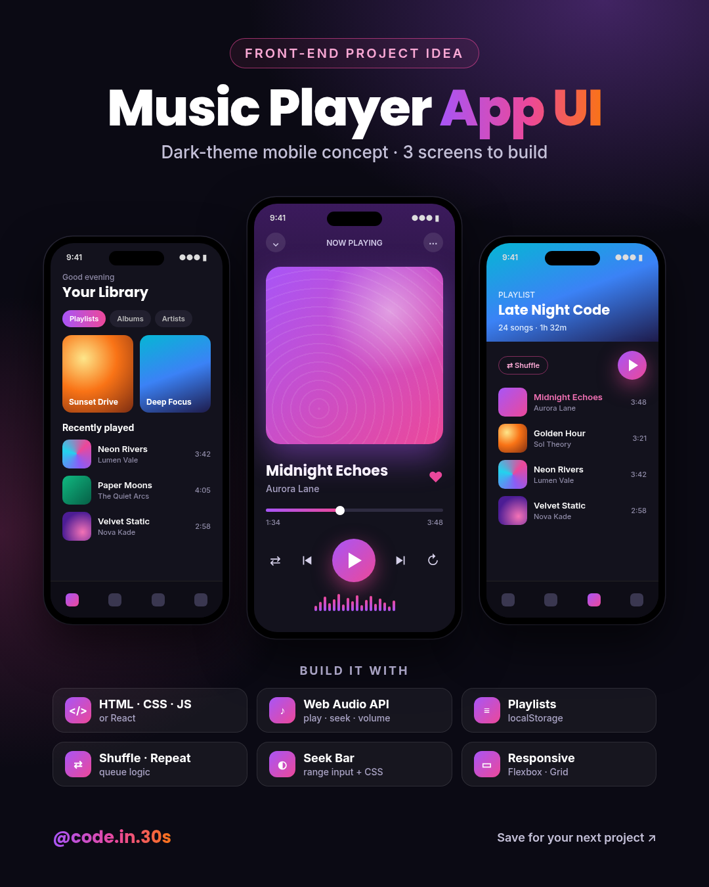
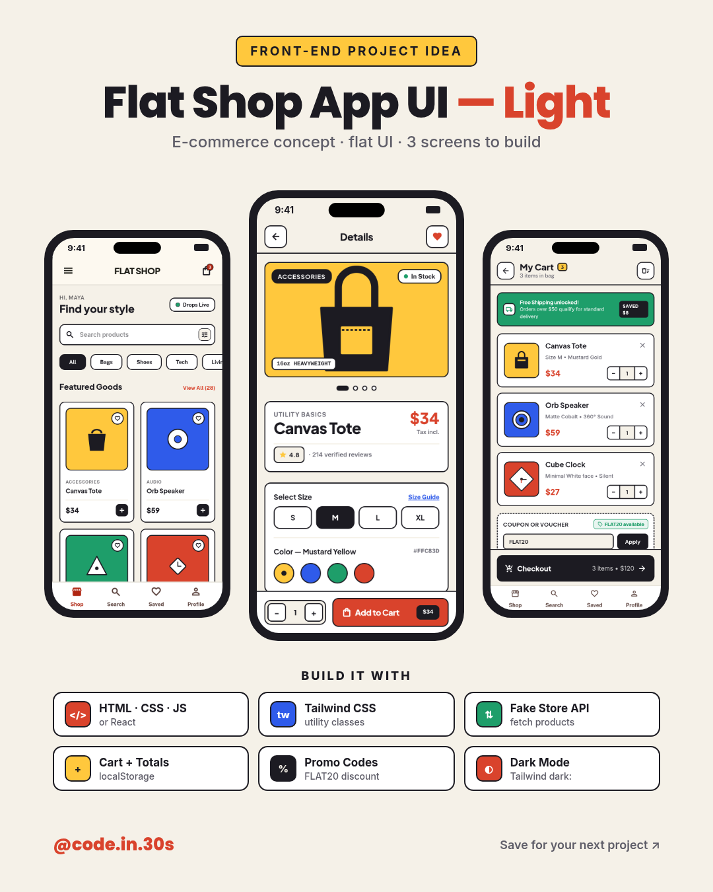
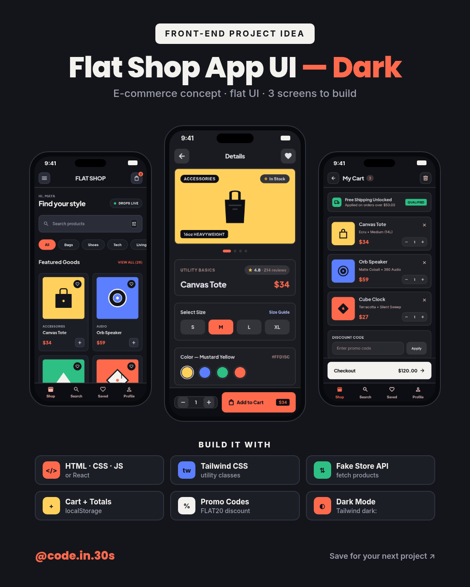

# UI Design Pins

Free front-end UI design concepts and project ideas for students, from [@code.in.30s](https://www.instagram.com/code.in.30s/) on Instagram.

Each pin is a finished mobile UI concept (often light + dark) with a short "build it with" stack so students can turn the screens into a portfolio project.

**Flat Shop UI Kit (code pack):** [narenkumar1.gumroad.com/l/flat-shop-ui-kit](https://narenkumar1.gumroad.com/l/flat-shop-ui-kit)

## Folder layout

```
designs/<YYYY-MM-DD>-<slug>/
  src/                 # HTML/CSS (and build helpers) for the pin layouts
  screens/             # optional: per-screen HTML + PNG used inside phone frames
  pinterest*.png       # 1000×1500 Pinterest-ready pin(s)
  instagram*.png       # 1080×1350 Instagram 4:5 image(s)
  notes.md             # palette, fonts, screens, stack, project idea
  pinterest.txt        # title, description, alt text, suggested board
  instagram-caption.txt
```

## How to re-render

Pins are plain HTML/CSS screenshots. With Google Chrome installed:

```bash
# Single self-contained pin (music player example)
google-chrome --headless=new --no-sandbox --disable-gpu --hide-scrollbars \
  --window-size=1000,1500 --virtual-time-budget=3000 \
  --screenshot=pinterest.png src/pinterest.html

google-chrome --headless=new --no-sandbox --disable-gpu --hide-scrollbars \
  --window-size=1080,1350 --virtual-time-budget=3000 \
  --screenshot=instagram.png src/instagram.html
```

For Flat Shop (framed multi-screen pins that reference `screens/*.png`):

```bash
cd designs/2026-10-10-flat-shop
# Optional: re-render each screens/*.html to screens/*.png first (same Chrome flags, phone size)
python3 src/build.py   # regenerates src/_*.html from template.html and screenshots pins
```

`build.py` expects to be run with the design folder as the working directory so paths like `src/template.html` and `../screens/` resolve correctly.

## Gallery

### Music Player App UI (dark theme)

[designs/2026-10-10-music-player/](designs/2026-10-10-music-player/)

Instagram: *not posted* (sample style pin)



### Flat Shop App UI (flat design, light + dark)

[designs/2026-10-10-flat-shop/](designs/2026-10-10-flat-shop/)

Instagram: [https://www.instagram.com/p/DeUPQmJG3Ek/](https://www.instagram.com/p/DeUPQmJG3Ek/)

Gumroad kit: [Flat Shop UI Kit](https://narenkumar1.gumroad.com/l/flat-shop-ui-kit)





## License / use

Design concepts here are shared so students can practice and learn. Recreate them in your own code for portfolio projects. Do not reclaim the Instagram posts or Gumroad product as your own listing without permission.
